# Logger com Platform Events para Salesforce

Framework de logging para Apex e Flow que registra erros e eventos de negócio **de forma que sobrevivam ao rollback da transação de origem**, com um LWC para consultar, filtrar e paginar os logs no servidor.

> Análise completa das opções de arquitetura, riscos e validação: [docs/logger-arquitetura.md](docs/logger-arquitetura.md).

## Por que isso existe

Se a transação de negócio faz rollback, qualquer `Log__c` gravado nela é desfeito. O Logger enfileira a entrada em memória, publica como `Log_Event__e` com `Publish Immediately`, e um trigger grava o `Log__c` em outra transação.

## Fluxo

```mermaid
sequenceDiagram
    autonumber
    participant N as Código de negócio (Apex ou Flow)
    participant L as Logger (buffer em memória)
    participant E as Log_Event__e (Publish Immediately)
    participant T as LogEventTrigger
    participant H as LogEventHandler
    participant D as Log__c

    N->>L: Logger.error(origem, exceção, recordId)
    Note over L: Só enfileira. Sem DML e sem evento.
    N->>N: Database.rollback(savepoint), se houve falha tratada
    N->>L: Logger.flush() (no finally)
    L->>E: EventBus.publish (lotes de 200)
    E-->>T: entrega (fora do controle do rollback de negócio)
    T->>H: handle(Trigger.new)
    Note over H: Ativa guarda anti-loop
    H->>D: Database.insert (SYSTEM_MODE)
    Note over H: Desativa guarda. Erro não é relançado.
```



## O que tem no projeto

| Camada | Itens |
|---|---|
| Dados | `Log__c` (objeto de log), `Log_Event__e` (transporte), `Logger_Settings__mdt` (nível mínimo) |
| API Apex | `Logger`, `LogLevel`, `LogSettings` |
| Persistência | `LogEventTrigger` → `LogEventHandler` |
| Flow | `LoggerInvocable` (Invocable Action "Registrar log") |
| Consulta | `LogViewerController` (paginação no servidor, `USER_MODE`) + LWC `logViewer` |
| Segurança | Permission sets `Logger_Writer`, `Logger_Viewer`, `Logger_Admin` |
| Testes | 4 classes de teste Apex (sem `SeeAllData`) + 7 testes Jest para o LWC |

## Uso

### Apex

```apex
public with sharing class ContratoService {
    public static void processar(Id contratoId) {
        Savepoint sp = Database.setSavepoint();
        try {
            // DML de negócio
            update new Contrato__c(Id = contratoId, Status__c = 'Ativo');
        } catch (Exception e) {
            Database.rollback(sp);
            Logger.error('ContratoService.processar', e, contratoId);
        } finally {
            Logger.flush();
        }
    }
}
```

Níveis: `Logger.debug`, `Logger.info`, `Logger.warn`, `Logger.error`. Entradas abaixo de `Logger_Settings__mdt.Minimum_Level__c` são descartadas antes de chegar ao buffer.

### Flow

Use a ação **Registrar log** (`LoggerInvocable`). Campos: `Nível` (DEBUG, INFO, WARN, ERROR), `Origem` (nome do Flow), `Mensagem` e `ID do registro` (opcional). Valor de nível inválido vira `INFO`. Uma invocação faz um único `flush`.

### Consulta

Atribua a permission set **Logger Viewer** ao usuário. A App Page **Logs da Aplicação** já contém o componente `logViewer`. Para vê-la, ative-a em *Setup → Lightning App Builder* e atribua-a a um app.

### Retenção

Não há política de retenção neste projeto. Os logs ficam na org até serem apagados manualmente.

## Deploy

Os metadados ficam em `projeto-entrevista/force-app/main/default/` (projeto SFDX da raiz). Para deployar **somente** o Logger, rode na pasta `projeto-entrevista`:

```bash
sf project deploy start -o <alias> \
  --source-dir force-app/main/default/objects/Log__c \
  --source-dir force-app/main/default/objects/Log_Event__e \
  --source-dir force-app/main/default/objects/Logger_Settings__mdt \
  --source-dir force-app/main/default/customMetadata/Logger_Settings.Default.md-meta.xml \
  --source-dir force-app/main/default/permissionsets/Logger_Writer.permissionset-meta.xml \
  --source-dir force-app/main/default/permissionsets/Logger_Viewer.permissionset-meta.xml \
  --source-dir force-app/main/default/permissionsets/Logger_Admin.permissionset-meta.xml \
  --source-dir force-app/main/default/classes/Log*.cls \
  --source-dir force-app/main/default/classes/Log*.cls-meta.xml \
  --source-dir force-app/main/default/classes/Logger*.cls \
  --source-dir force-app/main/default/classes/Logger*.cls-meta.xml \
  --source-dir force-app/main/default/triggers/LogEventTrigger.trigger \
  --source-dir force-app/main/default/triggers/LogEventTrigger.trigger-meta.xml \
  --source-dir force-app/main/default/lwc/logViewer \
  --test-level RunSpecifiedTests \
  -t LoggerTest -t LogEventHandlerTest -t LoggerInvocableTest -t LogViewerControllerTest
```

> Use `--dry-run` para validar sem gravar na org. Os caminhos com curinga (`Log*.cls`) dependem do shell; em PowerShell, passe a lista de arquivos explicitamente se o curinga não expandir.

## Testes e qualidade

```bash
# Apex: dry-run com testes (valida e roda os testes sem gravar na org)
sf project deploy start --dry-run -o <alias> --test-level RunSpecifiedTests -t LoggerTest ...

# LWC
npm install
npm test
npm run test:unit:coverage

# Análise estática (requer Java 11+ no PATH ou em JAVA_HOME)
npm run analyze
```

Resultados desta versão:

- Apex: 23/23 testes passando no deploy real contra a org `DevEd`; cobertura de 95,3% nas classes `Log*`/`Logger*`.
- Rollback: validado na org `DevEd` (conta revertida, log persistido).
- LWC: 7/7 testes Jest passando.
- Code Analyzer: nenhum achado de severidade 1 ou 2 nas classes do Logger.

## Decisões de segurança

- `Log__c` tem OWD `Private`. A visibilidade global vem da permission set `Logger Viewer`.
- Consultas do LWC rodam em `USER_MODE`, com bind variables.
- A gravação do handler roda em `SYSTEM_MODE`: é persistência interna de uma entrada já autorizada na origem. O usuário de origem é preservado em `User__c`.

## Pendências conhecidas

- Rollback validado na org `DevEd` para o caso tratado (savepoint + `flush` depois). Exceção não tratada que derruba a transação inteira não é coberta (seção 3.1 de [docs/logger-arquitetura.md](docs/logger-arquitetura.md)).
- Há um aviso de terceiros sobre aposentadoria do Standard Volume Platform Event. Não confirmado oficialmente; se confirmado, a arquitetura precisa do plano B descrito no documento.

## Estrutura

```
DevEd/
├── docs/
│   ├── logger-arquitetura.md   # análise de rollback, decisões e riscos
│   └── linkedin-post.md        # rascunho do post
└── (o código fica em ../force-app/main/default/, na raiz do projeto)
    ├── classes/                # Logger, LogSettings, LogEventHandler, LoggerInvocable, LogViewerController, testes
│   ├── triggers/               # LogEventTrigger
│   ├── objects/                # Log__c, Log_Event__e, Logger_Settings__mdt
│   ├── customMetadata/         # Logger_Settings.Default
│   ├── permissionsets/         # Logger_Writer, Logger_Viewer, Logger_Admin
│   └── lwc/logViewer/          # visualizador com filtros e paginação
│   └── flexipages/             # App Page Logs da Aplicação
```
