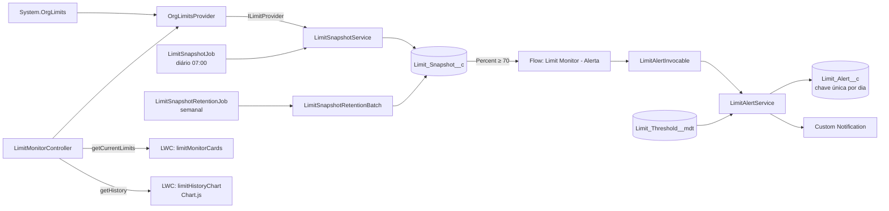

# Limit Monitor — Monitor de limites da org Salesforce

Um app que acompanha os limites da org (API diária, armazenamento, jobs assíncronos e outros), mostra o consumo em cards e gráfico de histórico, e avisa quando um limite passa do threshold configurado.

> **Status:** PoC funcional em Developer Edition. Veja [Limitações conhecidas](#limitações-conhecidas).


<!-- O GIF ainda não foi gravado. Grave a tela da Home Page com os cards e o gráfico, salve em docs/demo.gif e o link acima passa a funcionar. -->

## O que ele faz

- **Cards de limites atuais** com percentual de uso e status por faixa: normal abaixo de 70%, atenção de 70% a 90%, crítico acima de 90%.
- **Histórico** do uso por dia, em gráfico de linha (Chart.js), com linhas de referência em 70% e 90%.
- **Snapshot diário** dos limites, gravado em `Limit_Snapshot__c`.
- **Thresholds configuráveis** por limite, em Custom Metadata (`Limit_Threshold__mdt`), com flag para ativar ou desativar.
- **Alerta** quando um limite passa do threshold: um Flow chama a regra em Apex, grava um `Limit_Alert__c` e envia uma Custom Notification. Não há repetição no mesmo dia para o mesmo limite.
- **Retenção:** um job semanal apaga snapshots com mais de 90 dias.

## Arquitetura



### Decisões técnicas

**Leitura dos limites por `System.OrgLimits`, sem callout.** O app roda dentro da própria org, então a classe nativa é mais simples que chamar o endpoint REST `/limits`. Não há Named Credential para manter, não gasta limite de callouts e não depende de rede. O REST só faria sentido para monitorar outra org.

**Interface injetável para testar.** `OrgLimit` não pode ser instanciado em teste. Por isso, `OrgLimitsProvider` implementa `ILimitProvider` e devolve `LimitReading`, um DTO próprio. Nos testes, um provider fixo substitui os limites reais. As regras de percentual e de status são funções puras, testadas sem depender da org.

**Schedulable Apex em vez de Scheduled Flow.** A lógica de snapshot e de retenção fica em código, onde é testável com `Test.startTest` e `System.schedule`. Um Scheduled Flow é difícil de testar de forma automatizada. O Flow entra só no alerta, que é a parte de negócio e de notificação.

**Retenção em Batch.** Um batch apaga em lotes de 2.000 registros, com janela de 90 dias. O job semanal dispara o batch, que não sobrecarrega a transação.

**Dedupe no banco, não só no código.** `Limit_Alert__c` tem o campo `Alert_Key__c` como chave única, formada por limite e data. Mesmo se duas execuções rodarem ao mesmo tempo, o banco impede o alerta duplicado.

**Flow orquestra, Apex decide.** O Flow só entra quando o snapshot chega a 70% ou mais, o que reduz o volume. A regra de threshold, o dedupe e o envio da notificação ficam em `LimitAlertService`, que é testável. O tipo de notificação é buscado em tempo de execução, então não há ID fixo no metadado.

### Segurança

- As **leituras com dados do usuário** usam `WITH USER_MODE`, com `with sharing` nas classes.
- O acesso ao app é controlado pelo permission set **Limit Monitor User**, que dá leitura do objeto e dos campos e acesso às classes do controller.
- As **gravações feitas pelos jobs** rodam sem checar permissão do usuário: snapshots e alertas usam `AccessLevel.SYSTEM_MODE` explicitamente, e a retenção roda em contexto de sistema de batch. Essa é uma decisão de desenho, porque são processos internos e o usuário final nunca escreve nesses objetos.

## Estrutura do projeto

```
force-app/main/default/
├── classes/            Apex: controller, serviços, jobs, batch, invocable e testes
├── flows/              Limit_Monitor_Alerta (record-triggered)
├── lwc/                limitMonitorCards, limitHistoryChart (com testes Jest)
├── objects/            Limit_Snapshot__c, Limit_Alert__c, Limit_Threshold__mdt
├── customMetadata/     Threshold inicial para DailyApiRequests
├── notificationtypes/  Limit Monitor Alert
├── permissionsets/     Limit Monitor User
└── staticresources/    chartjs (Chart.js 4.5.1)
scripts/apex/          Scripts anônimos: agendamento e verificação
config/                project-scratch-def.json
```

## Como fazer o deploy

**Pré-requisitos:** Salesforce CLI, Node.js (para os testes Jest) e uma Developer Edition ou scratch org.

1. **Autorize a org**
   ```bash
   sf org login web --alias DevEd --set-default --instance-url https://login.salesforce.com
   ```

2. **Publique o código**
   ```bash
   sf project deploy start --source-dir force-app --target-org DevEd --test-level RunLocalTests
   ```

3. **Atribua o permission set** ao seu usuário
   ```bash
   sf org assign permset --name Limit_Monitor_User --target-org DevEd
   ```

4. **Agende os jobs** (diário e semanal). O comando é idempotente: se rodar de novo, substitui os agendamentos.
   ```bash
   sf apex run --file scripts/apex/limit-monitor-schedule.apex --target-org DevEd
   ```

5. **Coloque os componentes em uma página.** Em *Setup → Lightning App Builder*, edite a Home Page e adicione **Limit Monitor Cards** e **Limit History Chart**.

**Observação sobre deploy:** a org não aceita publicar classes que têm job agendado pendente. Se o deploy falhar com a mensagem de "trabalhos pendentes", suspenda os jobs em *Setup → Tarefas agendadas* (ou com `System.abortJob`), publique e rode o passo 4 de novo.

## Testes

| Tipo | Quantidade | Resultado |
|---|---|---|
| Apex (`RunLocalTests`) | 42 | 42 passando |
| Cobertura Apex (org) | — | 97% |
| Jest (LWC) | 7 | 7 passando |

Os testes Apex não usam `SeeAllData`. Os dados são criados dentro de cada teste, e os limites da org são lidos de forma real onde o teste precisa disso.

Para rodar os testes do LWC:
```bash
npm install
npm run test:unit
```

## Limitações conhecidas

- **Notificação para um único destinatário.** O alerta vai para o usuário que executa o job. Para várias pessoas, seria preciso uma lista de destinatários configurável.
- **Só notificação, sem e-mail.** O Flow envia a Custom Notification. O envio por e-mail ficou fora do escopo.
- **Thresholds só para o que está cadastrado.** Um limite sem registro no `Limit_Threshold__mdt` não gera alerta. Hoje só `DailyApiRequests` tem threshold (80%).
- **Análise estática parcial.** O PMD roda sem violações. O CPD não concluiu a análise no ambiente testado e o SFGE não tem pontos de entrada nas classes atuais. A validação completa ficou pendente.
- **Dados de teste.** Snapshots e alertas criados durante a validação ficam na org de desenvolvimento e podem ser apagados.

## Próximos passos

- Lista de destinatários configurável em Custom Metadata.
- Envio de e-mail além da notificação.
- Análise estática completa (PMD, CPD e SFGE) em CI.
- Pipeline de deploy com validação em pull request.
